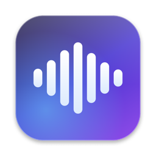

<p align="center"></p>

<h1 align="center">Voca</h1>
<p align="center"><b>Free, AI-powered voice dictation for macOS, in the style of Wispr Flow.</b><br>
Hold <kbd>Fn</kbd>, speak, and clean, punctuated, formatted text appears wherever your cursor is.<br>
Ask it a question instead and the answer shows up in a Liquid Glass popup.</p>

---

## Features
- **Hold Fn to talk** anywhere: Mail, Slack, Notes, your browser, your code editor.
- **AI cleanup:** fixes grammar and punctuation, removes "um" and "uh", applies your corrections ("at 5, no, at 6" becomes "at 6"), and turns "first… second…" into a `1.` `2.` list.
- **Knows when you're asking a question:** "what's the capital of Australia?" shows an answer popup and types nothing.
- **Double-tap Fn** locks recording on for long dictation. Tap once more to stop.
- **Liquid Glass UI** with a live waveform that follows your voice.
- **History with retry:** every dictation is kept for 24 hours. You can paste it again, copy it, or retry a failed one, and then it's deleted automatically.
- **Free, with fallbacks:** Groq, then OpenRouter, then OpenCode Zen. If you're offline, speech-to-text runs on-device with Apple's recognizer.
- **Light:** a native Swift app that uses about 40 MB of RAM. No Electron.

## Install (1 minute)

**Requirements:** macOS 26 (Tahoe) or newer, on Apple Silicon or Intel.

### Option A: one command (recommended)
Open **Terminal** and paste:
```bash
curl -fsSL https://raw.githubusercontent.com/Nagashreeshyl/voca/main/install.sh | bash
```

### Option B: download manually
1. Download **Voca-macOS.zip** from the [latest release](https://github.com/Nagashreeshyl/voca/releases/latest).
2. Unzip it and drag **Voca.app** into **Applications**.
3. Voca isn't notarized by Apple, so macOS blocks it the first time. Run this once:
   ```bash
   xattr -dr com.apple.quarantine /Applications/Voca.app
   ```
   Alternatively, open it, then go to System Settings → Privacy & Security and click **Open Anyway**.

### Option C: build from source
You need Xcode Command Line Tools (`xcode-select --install`).
```bash
git clone https://github.com/Nagashreeshyl/voca.git && cd voca
./build.sh          # builds a universal app and installs it to /Applications
```

## Set up (first launch)
1. **Add your API keys.** A window opens on first launch. Only **Groq** is required, and all three are free:
   | Provider | What it's for | Get a key |
   |---|---|---|
   | Groq | Speech-to-text and the main AI | [console.groq.com/keys](https://console.groq.com/keys) |
   | OpenRouter | Backup AI | [openrouter.ai/settings/keys](https://openrouter.ai/settings/keys) |
   | OpenCode Zen | Last backup | [opencode.ai/zen](https://opencode.ai/zen) |

   You can change them later from the menu bar: **API Keys…**
2. **Allow permissions** when macOS asks:
   - **Microphone**, to hear you.
   - **Accessibility**, to type into other apps: System Settings → Privacy & Security → Accessibility → turn on **Voca**. Then **quit and reopen Voca** from the menu bar.
3. **Free up the Fn key:** System Settings → Keyboard → **"Press 🌐 key to"** → **Do Nothing**. Under Keyboard → Dictation, set the shortcut to anything other than Fn.

## Use
| Action | What happens |
|---|---|
| Hold **Fn**, speak, release | Cleaned text is typed at your cursor |
| **Double-tap Fn** | Recording locks on; tap Fn again to stop |
| Ask a question | The answer appears in a popup (**Copy**, or **Esc** to close) |

Click the **waveform** in the menu bar to get:
- **Recent:** each dictation from the last 24 hours, with *Paste Again*, *Copy*, *Copy What I Said* and *Retry*.
- **Mode:** *Auto* (type or answer), *Dictation only* (never answers), or *Raw* (your exact words, no AI).
- **API Keys…**, **Launch at Login**, and **Advanced → Edit Models (JSON)** for swapping AI models.

## Troubleshooting
- **Nothing gets typed.** Accessibility is off. Voca copies the text to your clipboard instead, so you can press Cmd+V. Turn it on as described above, then quit and reopen Voca. The menu shows **⚠️ Allow Voca to type** while the permission is missing.
- **Fn opens emoji or dictation.** Set "Press 🌐 key to" → Do Nothing (see step 3).
- **"Couldn't transcribe."** Check your Groq key, then use **Recent → Retry**. Your audio is saved.
- **A free model stopped working.** Free models change. Use **Advanced → Edit Models** to change `groqModel` / `openrouterModel` / `opencodeModel`.

## Privacy
Your audio and text go only to the AI providers you set keys for. Your keys stay in `~/.config/voca/config.json`, which only your user account can read. History stays on your Mac in `~/Library/Application Support/Voca` and is deleted after 24 hours. There's no analytics and no server of our own.

## Development
- `./build.sh` builds `dist/Voca-macOS.zip` and installs to /Applications (`NO_INSTALL=1` skips the install).
- `/Applications/Voca.app/Contents/MacOS/Voca --selftest` runs the built-in checks.
- `swift Resources/make-icon.swift icon.png` regenerates the icon.

## License
MIT
